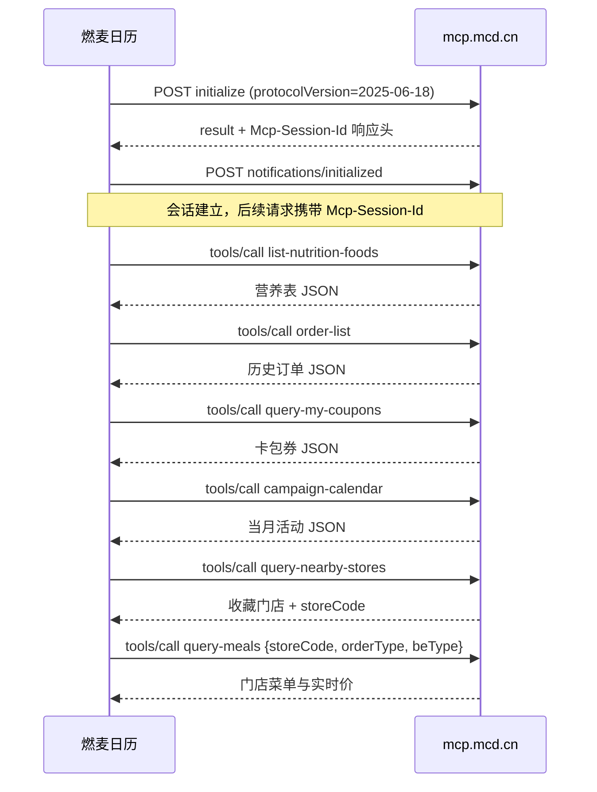

# MCP 集成说明

本文说明「燃麦日历」实际接入的麦当劳 MCP Server、调用的 Tool、完整调用流程，以及这些能力在产品中的业务价值。

---

## 1. 接入信息

| 项目 | 值 |
|---|---|
| MCP Server | 麦当劳中国 MCP Server（`https://mcp.mcd.cn`） |
| 传输方式 | Streamable HTTP（单端点 POST，响应可能是 `application/json` 或 `text/event-stream`） |
| 鉴权 | `Authorization: Bearer <MCD_MCP_TOKEN>`，Token 由用户在 [open.mcd.cn/mcp](https://open.mcd.cn/mcp) 自行申请 |
| 协议版本 | `2025-06-18` |
| 客户端实现 | 自研轻量客户端 `app/mcp_client.py`，仅依赖 `httpx` |
| 限流 | 600 次/分钟，客户端对 429 给出明确中文提示 |
| 工具总数 | 服务端提供 35 个工具，本项目使用其中 8 个（均不产生下单、领券等写操作） |

配置模板见仓库根目录 [`mcp-config.example.json`](./mcp-config.example.json)，仅包含 `${MCD_MCP_TOKEN}` 占位符。

---

## 2. 使用的 Tool 与业务用途

| Tool | 调用参数 | 返回值处理 | 业务用途 | 代码位置 |
|---|---|---|---|---|
| `list-nutrition-foods` | 无 | 解析 9 列营养表为结构化 JSON（能量/蛋白质/脂肪/碳水/钠/钙） | 建立餐品营养库，是热量预算与套餐推荐的基础数据 | `tools.fetch_nutrition` → `catalog.parse_nutrition_payload` |
| `order-list` | 无 | 取 `data.list`，按 `createTime` 拆分日期与餐次，展开 `comboItemList` | 导入历史消费 → 自动填充日历 + 训练口味画像 | `tools.fetch_orders` / `tools.orders_to_meals` |
| `query-my-coupons` | `page=1, pageSize=200` | 取 `data.coupons`，用正则解析「满 X 减 Y」「X 元商品」 | 结构化优惠券，供推荐引擎计算券后价 | `tools.fetch_coupons` / `tools.parse_coupon` |
| `campaign-calendar` | 无 | 展平 `dailyList[].events[].articleDto` | 在首页展示进行中的营销活动 | `tools.fetch_campaigns` |
| `query-nearby-stores` | `beType=1, searchType=1`（收藏门店） | 取 `storeCode` | 自动定位用户常用门店，作为实时菜单的入口 | `tools.fetch_favorite_stores` |
| `query-meals` | `storeCode, orderType=1, beType=1` | 递归遍历任意嵌套结构，提取商品名/价格/`productCode` | 获取门店实时菜单与价格，覆盖离线参考价 | `tools.fetch_store_menu` → `catalog.extract_products` |
| `calculate-price` | `storeCode, items[{productCode, quantity, couponCode}]` | 返回含优惠的结算价（单位：分） | 官方口径核验券后价格，**仅计算，不下单** | `tools.calculate_price` |
| `available-coupons` | 无 | 取可领取券列表 | 联调探针验证 + 后续「一键领券」入口预留 | `tools.fetch_claimable_coupons` |

> `scripts/probe_mcp.py` 另外只读试调 `now-time-info` 与 `query-my-account`，用于验证握手、会话与返回结构；这两个工具不参与主业务流程。

**刻意不使用的工具**：`create-order`、`mall-create-order`、`party-order-create`、`auto-bind-coupons`、`draw-lottery`、`cancel-order` 等写操作。本项目定位是「帮你决定吃什么、花多少」，下单与领券仍由用户在麦当劳官方 App 完成。

---

## 3. 调用流程

### 3.1 协议时序



所有请求共用一个 `MCPClient` 会话（`app/main.py::_run_sync`），避免重复握手。

### 3.2 客户端实现要点

`app/mcp_client.py` 做了四件事：

1. **会话管理**：从响应头读取 `Mcp-Session-Id`，后续请求自动回传，并带上 `MCP-Protocol-Version`
2. **双响应格式**：`Content-Type` 为 `text/event-stream` 时按 SSE 切分 `data:` 行并挑选与请求 `id` 匹配的消息；否则直接解析 JSON
3. **结果归一化**：优先取 `structuredContent`；否则解析 `content[].text`（服务端常把 JSON 序列化进 text 块）；`isError` 统一抛 `MCPError`
4. **错误语义**：401 → Token 无效/过期；429 → 触发 600 次/分钟限流；其他 4xx/5xx 由 `httpx` 抛出

---

## 4. 数据如何进入业务模型

```
list-nutrition-foods ──▶ menu 表（158 道餐品的 kcal/蛋白/脂肪/碳水/钠/钙）
order-list ────────────▶ meal_log 表（按日期 + 时段归档，source = order:<orderId>）
query-my-coupons ──────▶ coupon 表（满减 / 一口价，结构化 min_spend、value、match_text）
query-meals ───────────▶ 回填 menu 的实时 price 与 product_code（price_is_estimate=0）
campaign-calendar ─────▶ kv 表（首页活动位）
```

几个关键处理：

- **订单去重**：每条导入记录带 `source = order:<orderId>`，重复同步不会重复计入
- **套餐展开**：订单里的 `comboItemList` 会拆成单品逐项计算营养，而不是把套餐当成一个黑盒
- **时段推断**：根据 `createTime` 的小时数映射到早餐/午餐/下午茶/晚餐/夜宵
- **名称匹配**：订单商品名与营养库对齐；匹配不到时保留名称、营养记 0，并用参考价兜底
- **价格兜底**：门店打烊时 `query-meals` 返回 `code 600057`，此时继续使用营养库参考价，只把错误写入同步摘要

---

## 5. 业务价值

| MCP 能力 | 对用户的价值 | 对比赛的意义 |
|---|---|---|
| 营养数据 | 不用手查热量表，158 道餐品精确到蛋白质与钠 | 让「热量预算」有可信数据源，而不是拍脑袋估算 |
| 历史订单 | 打开应用就有日历和口味画像，零成本冷启动 | 证明 MCP 数据能直接驱动个性化推荐，而非静态展示 |
| 优惠券 | 推荐直接给出「券后实付价」，并自动选最划算的券 | 把优惠券从「用户自己翻卡包」变成「推荐的一部分」 |
| 门店菜单 | 实时价格参与打分，避免按过时参考价推荐 | 打通线上决策与线下门店真实供给 |
| 营销活动 | 首页展示当月活动 | 让用户顺便发现新品与活动，形成消费闭环 |

产品闭环：**运动 → 预算 → 推荐 → 用券 → 记录 → 更懂你**。MCP 提供了闭环中「真实餐品、真实价格、真实优惠、真实历史」四类数据，缺一不可。

---

## 6. 如何核验

```bash
# 1. 只读探针：握手、工具清单、返回结构
python scripts/probe_mcp.py

# 2. 启动服务并触发一次同步
uvicorn app.main:app --port 8000
curl -X POST http://127.0.0.1:8000/api/sync -H "Content-Type: application/json" -d "{}"

# 3. 查看同步状态
curl http://127.0.0.1:8000/api/status
```

返回的同步摘要包含营养条数、订单数、导入餐次数、券数、门店菜单条数，以及按工具分类的 `errors` 列表。

---

## 7. 安全与隐私

- Token 只从环境变量或本地 `.env` 读取，不写死、不提交；仓库配置模板用 `${MCD_MCP_TOKEN}` 占位
- 所有 MCP 数据落在本机 SQLite（`data/ranmai.db`），该目录已被 `.gitignore` 排除
- 不调用任何写操作，不创建订单、不领券、不参与抽奖
- 不向第三方上传任何数据；不存在共享的服务端账号

---

## 8. 后续可扩展

- 用 `calculate-price` 对三套推荐实时核价，展示「官方价 vs 估算价」差异
- 接入 `auto-bind-coupons` 前增加用户显式确认，避免自动领券带来的副作用
- 根据 `query-meal-detail` 的特制选项支持「少酱/去盐」等减脂化配置
- 把 `parse_coupon` 扩展为按门店 + 订单类型过滤，精确到「本单可用」
