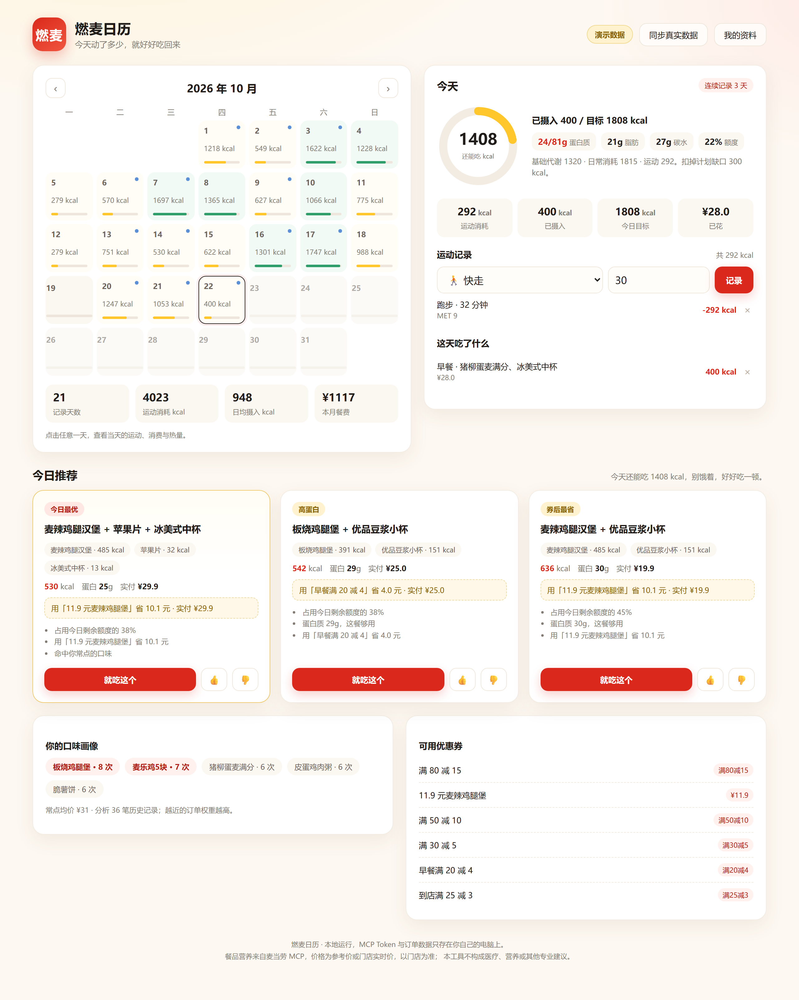
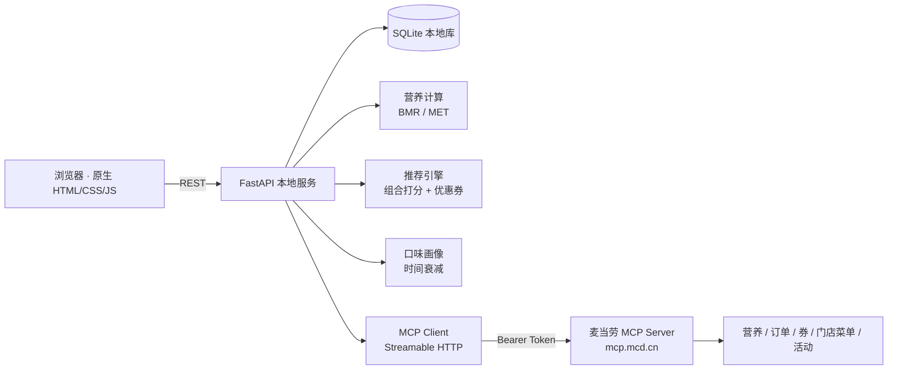

# 燃麦日历 · RanMai Calendar

> 今天动了多少，就好好吃回来。

一个跑在你自己电脑上的「麦当劳 × 健身减脂」日历。它读取你的运动消耗，算出今天还能吃多少，再用麦当劳官方 MCP 数据为你搭配套餐、比价用券，并从每一次点单里学习你的口味。

> ⭐ 如果这个项目让你少算了一次热量，欢迎点个 Star，帮我冲进麦当劳开发者大赛前 100。

[](https://www.python.org/)
[](https://fastapi.tiangolo.com/)
[](https://open.mcd.cn/mcp)
[](./LICENSE)



---

## 这个项目解决什么问题

减脂的人打开外卖软件，通常要同时回答三个问题：**今天还能吃多少？吃什么不超？怎么买最便宜？**

现有工具只解决其中一个：热量 App 不知道麦当劳菜单和优惠券，外卖 App 不关心你的运动量，优惠券平台更不懂你今天跑了 5 公里。

**燃麦日历把这三件事串成一条线：**

```
运动消耗 ──▶ 今日热量预算 ──▶ 套餐搭配 ──▶ 优惠券比价 ──▶ 一键记录
     ▲                                                        │
     └──────────────── 口味画像持续学习 ◀────────────────────────┘
```

---

## 核心功能

| 功能 | 说明 |
|---|---|
| 🏃 **运动消耗记录** | 18 种常见运动，按 MET × 体重 × 时长自动计算消耗；也可以只记饮食 |
| 🎯 **今日热量预算** | Mifflin-St Jeor 算基础代谢 + 活动系数 + 运动消耗 − 减脂缺口，并设安全下限 |
| 🍔 **套餐推荐** | 从主食 / 小食 / 饮品组合出 2500 种搭配，按时段、剩余热量、蛋白质、口味、价格综合打分 |
| 🎫 **优惠券比价** | 自动解析满减券、指定商品一口价券，取「券后实付最低」的方案；夜宵不会推 900 kcal 的三人餐 |
| 🧠 **口味学习** | 每次点单和 👍/👎 都会进入画像；30 天半衰期，越近的订单权重越高 |
| 📅 **日历复盘** | 每天的摄入、运动、花费、是否超标一眼可见；支持回看任意一天并重新推荐 |

### 推荐是怎么算出来的

```
剩余额度 = max(每日目标 − 已摄入, 0)
单餐目标 = min(剩余额度, 时段上限)       # 下午茶 400 / 夜宵 550 / 午餐 900 kcal
总分 = 0.30 × 口味契合 + 0.24 × 热量贴合 + 0.24 × 蛋白质达成
     + 0.12 × 价格贴合 + 0.10 × 优惠力度
```

- **口味契合**来自历史订单的品类/单品频次，带 30 天时间衰减，反馈权重 +1.6 / −1.2
- **热量贴合**优先命中单餐目标，而不是「剩多少吃多少」
- **蛋白质**默认 1.4 g/kg 体重，一餐按目标值的 35% 计
- **优惠力度**比较所有可用券，按券后实付价排序

---

## 目标用户

- **减脂期的上班族**：午休点麦当劳，想知道这一顿会不会把今天的额度用爆
- **健身爱好者**：练完想吃高蛋白，但不想自己算鸡胸和汉堡的差距
- **麦门薅券党**：手里一堆券，想知道哪张用在这单最划算
- **想养成记录习惯的人**：不需要手动查营养表，点完顺手记一笔即可

> 本项目为个人健康记录工具，不提供医疗或营养诊断建议；餐品营养、价格与供应以麦当劳官方渠道为准。

---

## 快速开始

### 环境要求

- Python 3.10 及以上（开发环境为 3.14）
- Windows / macOS / Linux 均可，无需 Node.js

### 1. 安装

```bash
git clone https://github.com/<your-name>/ranmai-calendar.git
cd ranmai-calendar

python -m venv .venv
# Windows PowerShell
.venv\Scripts\Activate.ps1
# macOS / Linux
# source .venv/bin/activate

pip install -r requirements.txt
```

### 2. 先跑起来看看（演示模式，不需要 Token）

```bash
uvicorn app.main:app --port 8000
```

打开 <http://127.0.0.1:8000>。

首次启动会自动装载 **158 道麦当劳真实营养餐品** 和 21 天示例记录，口味画像、日历、推荐开箱即用。所有示例数据标记为 `demo`，可以随时删库重来。

### 3. 接入真实麦当劳 MCP（可选）

1. 在 [麦当劳 MCP 开放平台](https://open.mcd.cn/mcp) 申请 Token
2. 复制配置模板：

   ```bash
   cp .env.example .env
   ```

3. 编辑 `.env`，填入你的 Token：

   ```dotenv
   MCD_MCP_TOKEN=你的_token
   ```

4. 重新启动服务，页面右上角会从「演示数据」变成「实时数据」，并自动后台同步

也可以随时点页面上的 **同步真实数据** 手动触发。同步内容包括：

- 餐品营养库（`list-nutrition-foods`）
- 历史订单 → 自动折算成餐次记录（`order-list`）
- 卡包优惠券（`query-my-coupons`）
- 当月营销活动（`campaign-calendar`）
- 收藏门店的实时菜单与价格（`query-nearby-stores` + `query-meals`）

> 门店菜单只在营业时间内返回。打烊时会自动沿用营养库里的参考价，并给出提示，不影响其他功能。

### 4. 验证 MCP 连通性（可选）

```bash
# Windows PowerShell
$env:MCD_MCP_TOKEN="你的_token"; python scripts/probe_mcp.py
# macOS / Linux
MCD_MCP_TOKEN=你的_token python scripts/probe_mcp.py
```

探针只调用只读工具，**不会下单、领券或取消订单**。

---

## 使用示例：减脂期的一天

1. **早上 8:00** 打开页面，记一笔「跑步 32 分钟」→ 按 58 kg 体重算出约 292 kcal 消耗
2. 系统把今日目标从 1808 kcal 提高到 2100 kcal，并重新计算可摄入额度
3. **中午 12:00** 页面按「午餐」时段给出 3 个方案：

   | 方案 | 组合 | 热量 | 蛋白 | 券后价 |
   |---|---|---|---|---|
   | 今日最优 | 麦辣鸡腿堡 + 中薯条 + 优品豆浆 | 925 kcal | 34 g | ¥30.9（省 10.1） |
   | 高蛋白 | 麦辣鸡腿堡 + 麦乐鸡 5 块 + 优品豆浆 | 849 kcal | 42 g | ¥31.9（省 10.1） |
   | 券后最省 | 麦辣鸡腿堡 + 中薯条 + 可乐 | 921 kcal | 28 g | ¥31.9（省 10.1） |

4. 点 **就吃这个** → 自动按最优券记账，日历当天变绿
5. 吃完点 👍 / 👎，下一次推荐会更懂你
6. **月底** 回看日历：21 天有记录、运动消耗 4023 kcal、餐饮花费 ¥1117、日均 948 kcal

---

## 技术架构



```
ranmai-calendar/
├─ app/
│  ├─ main.py           # FastAPI 路由与同步编排
│  ├─ mcp_client.py     # MCP JSON-RPC / SSE 客户端
│  ├─ tools.py          # MCP 工具 → 业务动作
│  ├─ nutrition.py      # BMR / TDEE / MET / 安全下限
│  ├─ recommend.py      # 套餐组合、打分、优惠券
│  ├─ taste.py          # 时间衰减口味画像
│  ├─ catalog.py        # 餐品分类、参考价、营养表解析
│  ├─ menu_reference.py # 158 道真实营养数据（离线兜底）
│  ├─ demo_data.py      # 演示数据播种
│  ├─ db.py             # SQLite 存储
│  └─ static/           # 前端页面
├─ scripts/probe_mcp.py # MCP 只读联调探针
├─ .env.example
├─ mcp-config.example.json
├─ MCP_INTEGRATION.md   # MCP 接入说明
└─ CONTEST_DECLARATION.md
```

### 为什么是本地应用

麦当劳 MCP Token 代表**用户本人身份**，可以读取历史订单、卡包和积分。因此本项目刻意做成「每台电脑跑一份」：Token 与订单数据只存在本机 `data/`（已在 `.gitignore` 中排除），不做云端账号体系，也不收集任何用户数据。

---

## MCP 集成

完整说明见 [MCP_INTEGRATION.md](./MCP_INTEGRATION.md)，包含：

- 使用的 MCP Server 与 8 个 Tool、各自参数与返回值处理
- `initialize → notifications/initialized → tools/call` 调用时序
- 订单如何折算成餐次、优惠券如何解析成结构化规则
- 边界处理：401、429、门店打烊、空数据、演示模式降级

---

## 常见问题

**Q：没有 Token 能用吗？**
能。演示模式包含 158 道真实营养餐品 + 参考价 + 示例记录，除「实时数据」外全部功能可用。

**Q：会泄露我的订单和 Token 吗？**
不会。Token 只从环境变量 / 本地 `.env` 读取，`.env`、`data/`、`mcp_tools.json` 均已被 `.gitignore` 排除；仓库中的 `mcp-config.example.json` 只含 `${MCD_MCP_TOKEN}` 占位符。

**Q：能自动下单吗？**
不会。本项目只调用只读工具与 `calculate-price`（仅计算价格），不会创建订单、领券或扣积分。

**Q：热量数据准吗？**
营养数据来自麦当劳 MCP 的 `list-nutrition-foods`；参考价用于离线兜底，接入门店后会被实时价格覆盖。个体差异很大，请把结果当作参考，而不是医学建议。

**Q：为什么推荐里下午茶只给 400 kcal？**
单餐热量上限按时段设定（早餐 700 / 午餐 900 / 下午茶 400 / 晚餐 850 / 夜宵 550），避免深夜给出超量组合。可在 `app/recommend.py` 的 `SLOT_AIM_CAP` 调整。

---

## 参赛说明

本项目参加「麦当劳程序员节创意开发大赛」。

- 参赛声明见 [CONTEST_DECLARATION.md](./CONTEST_DECLARATION.md)
- 项目未内置任何真实 Token、密钥或他人个人信息
- 如果这个项目对你有帮助，欢迎点一个 ⭐ Star

## License

[MIT](./LICENSE)
